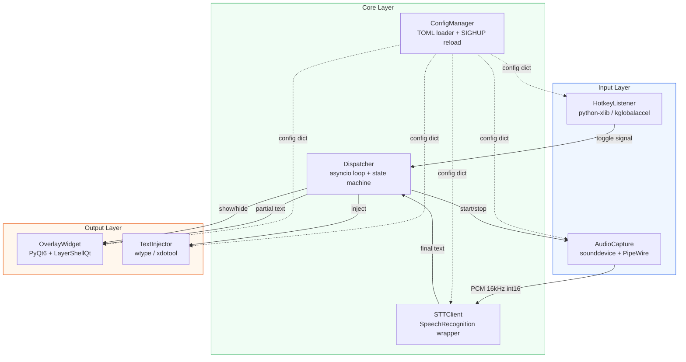
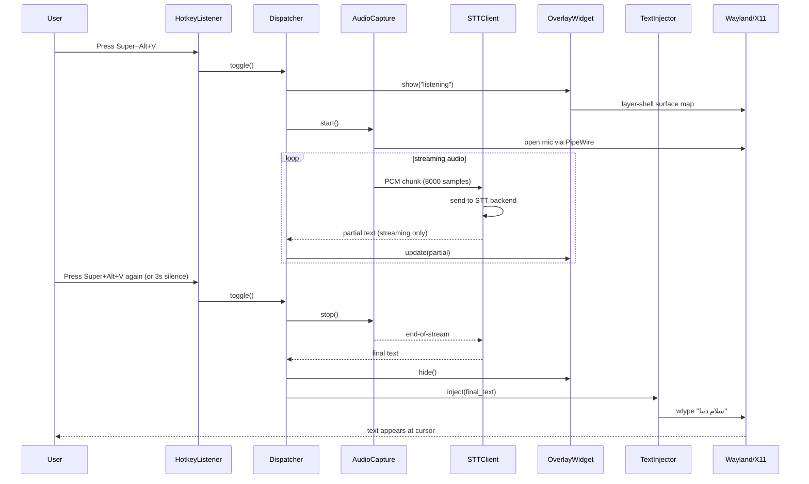
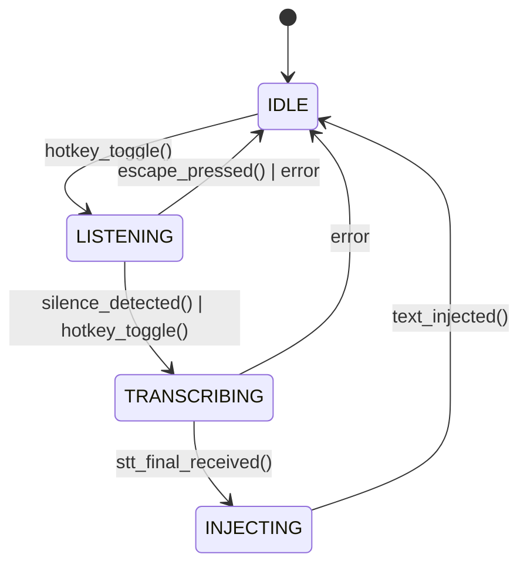

# VoiceType — Voice-to-Text Overlay Daemon for Arch Linux / KDE Plasma

### Architecture & Research Document

**Document version:** 1.0
**Target OS:** Arch Linux with KDE Plasma 6 (Wayland primary, X11 fallback)
**Project type:** Linux desktop daemon + on-demand overlay UI
**Document scope:** Full architecture blueprint with code samples, install guide, customization, roadmap

> ## ⚠️ Errata — revision 1.1 (supersedes conflicting text below)
>
> The original draft was written without access to `ref-src/`. After reading `hyprwhspr` and `vosk-api`,
> these decisions replace the original ones (details: `docs/adr/`, `docs/notes-hyprwhspr.md`):
>
> | Topic | Original | Now |
> |---|---|---|
> | Overlay toolkit | PyQt6 + `voicetype._layershell` shim | **GTK4 + gtk4-layer-shell** — the shim does not exist; no Python binding for LayerShellQt (ADR-0003) |
> | Overlay packages (Arch) | `qt6-base`, `qt6-declarative`, `qt6-wayland`, `layer-shell-qt`, `python-pyqt6` | **`gtk4`, `gtk4-layer-shell`, `python-gobject`, `python-cairo`** (`packaging/PKGBUILD`; the package list in §9.1 is the original draft) |
> | Text injection (Wayland) | `wtype` | **clipboard + `ydotool` paste** (Ctrl+Shift+V for terminals), `wtype` fallback — KWin lacks virtual-keyboard (ADR-0002) |
> | Hotkey | `kglobalaccel` D-Bus / python-xlib | **KDE Custom Shortcut → `voicetype toggle`**; optional evdev for hold mode (ADR-0004) |
> | External control | `pkill -SIGUSR1 -f ...` | **Unix socket** `$XDG_RUNTIME_DIR/voicetype.sock`, mode 0600 |
> | Silence detection | fixed N seconds | **adaptive noise-floor calibration**, armed only after speech |
> | Google free | `SpeechRecognition`, no policy | same library, plus timeout/retry/chunking/fallback to Vosk (ADR-0005) |
> | systemd unit | `Requires=graphical-session.target`, `%{WAYLAND_DISPLAY}` | `PartOf`/`After`, display wait helper, no invalid specifiers (`packaging/voicetype.service`) |
>
> Code-sample bugs in the original (fixed in the real package, **not** in the samples below): missing `import sys` in §8.3;
> `grab_key(ord('v'))` uses a keysym where a keycode is required (§8.2); `recognize_google` receives the whole utterance
> (not streaming); `%{WAYLAND_DISPLAY}` is not a systemd specifier and `Requires=graphical-session.target` is wrong for
> a user unit (§9.4); the English-term regex in §10.5 cannot match Persian transliterations like «پایتون» (now a two-way
> dictionary, `voicetype/postprocess/terms.py`); the `Config` dataclass in §7.1 is flat — the real one is nested
> (`[hotkey] [stt] [audio] [overlay] [injector] [postprocess]`).


---

## Table of Contents

1. [Executive Summary](#1-executive-summary)
2. [Project Goals & Non-Goals](#2-project-goals--non-goals)
3. [Target Environment](#3-target-environment)
4. [STT Engine Research](#4-stt-engine-research)
5. [Analysis of Cloned Repositories](#5-analysis-of-cloned-repositories)
6. [Architecture Overview](#6-architecture-overview)
7. [Module Design](#7-module-design)
8. [Code Samples](#8-code-samples)
9. [Installation Guide](#9-installation-guide)
10. [Customization Options](#10-customization-options)
11. [Development Roadmap](#11-development-roadmap)
12. [References & Resources](#12-references--resources)

---

## 1. Executive Summary

VoiceType is a user-space Linux daemon that converts spoken voice into typed text at the current cursor position. The intended experience mirrors Google's GBoard voice input on Android: the user presses a configurable global hotkey (e.g. `Super+Alt+V`), a small floating overlay appears showing microphone activity, the user speaks in Persian (with mixed English terms), and the resulting transcript is injected directly at the focused cursor — wherever it happens to be: a browser address bar, a Telegram message field, a JetBrains IDE, a terminal, or a LibreOffice document.

The recommended stack is **Python 3.11+**, **PyQt6** for the overlay UI (using KDE's `LayerShellQt` integration for native Plasma 6 Wayland placement), **SoundDevice / SoundFile** for microphone capture via PipeWire, **SpeechRecognition** as the STT abstraction layer, **wtype** for Wayland text injection (with **xdotool** as an X11 fallback), and the **Google Web Speech API free endpoint** (the same one Chrome uses) as the primary STT engine because it offers excellent Persian accuracy and handles mixed-script Persian+English input gracefully. **Vosk** (offline, Persian model `vosk-model-small-fa-0.42`) and **OpenAI Whisper** (CPU/GPU) are recommended as offline fallbacks when the user has no internet or wants full privacy.

The proposed application is intentionally narrow in scope: a single-user, single-keystroke, single-stream dictation tool — not a full transcription editor, not a TTS engine, not a chatbot. This narrow scope keeps the codebase small (target: <3000 LOC for the MVP), keeps the user experience snappy (target latency from key-press to first character: <1.5 seconds on a typical home broadband), and keeps the dependency surface minimal so that it can be packaged as a clean AUR package without pulling in heavy frameworks like Electron or full browser stacks.

The remainder of this document walks through the target environment, surveys and ranks STT options, analyzes the two reference repositories the user has already cloned (`hyprwhspr` and `vosk-api`), presents the module-level architecture with Mermaid diagrams, gives runnable code samples for every critical path, provides a step-by-step Arch Linux install guide, lists all user-tunable customization knobs with their default values, and ends with a four-phase development roadmap calibrated to a 12-week solo-developer schedule.

---

## 2. Project Goals & Non-Goals

### 2.1 Functional Goals

The application must satisfy the following use cases end-to-end. Each is described from the user's perspective so that subsequent sections can be validated against it.

- **G1 — Global hotkey activation.** The user can press a configurable key combination (default: `Super+Alt+V`) from anywhere on the desktop — regardless of which window is focused — and the application transitions from idle to "listening" within 500 ms.
- **G2 — Microphone overlay.** While listening, a small floating overlay appears (default: top-center of the screen, 360×96 px) showing a real-time audio level meter and a status label ("listening"). The overlay is always-on-top, click-through, and respects Plasma 6's layer-shell protocol so it does not steal focus.
- **G3 — Persian-primary STT with English term handling.** The default recognition language is Persian (`fa-IR`) but the engine must correctly transcribe common English technical terms (e.g. "Linux", "Python", "Qt", "Wayland") embedded in Persian speech — exactly how GBoard does it.
- **G4 — Cursor-position text injection.** The transcribed text is typed at the currently focused cursor position using a virtual keyboard protocol — `wtype` on Wayland, `xdotool` on X11 — so the text appears wherever the user was typing, with no clipboard pollution and no window-switching side effects.
- **G5 — Stop conditions.** Listening stops when (a) the user presses the hotkey again (toggle mode), (b) the user presses `Escape`, or (c) the engine detects `N` consecutive seconds of silence (configurable, default 3 s). On stop, the overlay disappears within 300 ms.
- **G6 — Persistent configuration.** All user-tunable knobs (hotkey, STT provider, overlay position, language pair, silence threshold, post-processing rules) live in a single TOML file at `~/.config/voicetype/config.toml`. Changes to the file are picked up on next invocation; an SIGHUP triggers a live reload.
- **G7 — Offline fallback.** When the user explicitly sets `provider = "vosk"` or `provider = "whisper"` in the config, the application works fully offline with no network traffic and no API key.
- **G8 — Auto-start on login.** The application ships with a `voicetype.service` systemd user unit and a `voicetype.desktop` autostart entry so it can be enabled once and survive reboots.

### 2.2 Non-Goals

The following capabilities are explicitly **out of scope** for this version. They may be added later as plugins or downstream forks.

- **NG1 — No full document transcription.** VoiceType is not a tool for transcribing 30-minute podcasts or recorded meetings. It is designed for short burst dictation (target: 1–60 seconds per session). Long-form transcription is a different problem class with different UX (timeline view, edit mode, export) and is left to tools like Whisper.cpp GUI or ParlaScribe.
- **NG2 — No Text-to-Speech.** VoiceType only converts voice → text, not the reverse. TTS is a separate concern with separate dependencies and is left to `espeak-ng`, `piper`, or `mimic3`.
- **NG3 — No speaker identification or diarization.** The application does not distinguish between multiple speakers.
- **NG4 — No multi-user / no network service.** VoiceType is a single-user desktop tool. It does not expose a TCP port, an HTTP API, or any RPC. It is not designed to run as a server for other machines.
- **NG5 — No mobile / no cross-platform in v1.** Although the underlying stack (Python, PyQt, Vosk, Whisper) is portable to macOS and Windows, v1 is built for and tested on Arch Linux + KDE Plasma 6 Wayland only. Cross-platform packaging is a Phase 4 stretch goal, not a v1 requirement.
- **NG6 — No editor integration.** VoiceType does not ship plugins for VSCode, JetBrains, Vim, or LibreOffice. Because text is injected at the cursor via virtual keyboard events, every application that accepts keyboard input automatically works as a target — no per-app integration needed.

---

## 3. Target Environment

### 3.1 Operating System & Compositor

VoiceType targets **Arch Linux** with **KDE Plasma 6** running on **Wayland** (the default since Plasma 5.27+). Arch is chosen as the primary platform because (a) the user already runs it, (b) its rolling-release model gives access to the latest PipeWire, Qt 6, and Wayland protocols, and (c) the AUR makes first-party packaging straightforward. KDE Plasma 6 ships with full Wayland support including the `wlr-layer-shell` protocol via `kwayland-server`, which is what makes always-on-top, click-through, focus-agnostic overlays possible.

A secondary, lighter-weight test path covers **X11 sessions** (still selectable from the SDDM login screen) for users on older GPUs or proprietary NVIDIA drivers that misbehave on Wayland. The architecture treats Wayland as primary and falls back to X11 via `xdotool` and `python-xlib` — see §7 for the abstraction layer.

### 3.2 System Services & Libraries

The following system packages form the runtime baseline. All of them are available in the official Arch repositories (`core`, `extra`) or the AUR. No third-party repos are required.

| Component | Package (pacman/AUR) | Purpose | Notes |
|---|---|---|---|
| Wayland compositor | `plasma-desktop` (meta) | KDE Plasma 6 desktop shell | Already installed by user |
| Audio server | `pipewire`, `pipewire-pulse`, `pipewire-alsa`, `pipewire-jack` | Modern audio subsystem | Replaces PulseAudio; ships with Plasma 6 |
| Realtime scheduling | `realtime-privileges` (AUR) + `rtkit` | Boosts audio thread priority to avoid underruns | Add user to `realtime` group |
| Qt 6 runtime | `qt6-base`, `qt6-declarative`, `qt6-wayland` | GUI framework + Wayland platform plugin | Pulled in by `plasma-desktop` |
| Layer-shell Qt | `layer-shell-qt` (extra) | KDE's Qt wrapper around `wlr-layer-shell` | Required for native Plasma overlay |
| Virtual keyboard (WL) | `wtype` (community) | Inject keystrokes on Wayland | Default text-injection backend |
| Virtual keyboard (X11) | `xdotool` (extra) | Inject keystrokes on X11 | Fallback path |
| Audio capture helpers | `python-sounddevice`, `python-soundfile` (extra) | NumPy-aware mic input via PortAudio | Wraps PipeWire via `pulseaudio` backend |
| STT engine | `python-speechrecognition` (extra) | Unified API across Google / Vosk / Whisper | Primary abstraction layer |
| Offline STT (Vosk) | `python-vosk` (extra) | Vosk Python bindings | Optional — only if user picks `provider = "vosk"` |
| Persian Vosk model | `vosk-model-fa` (AUR candidate, or manual download) | Persian acoustic model, ~53 MB small / ~1.6 GB large | See §9 for install steps |
| Whisper (optional) | `python-openai-whisper` (extra, large) | OpenAI Whisper local inference | Optional, GPU recommended |
| Config parser | `python-tomli` + `python-tomli-w` (extra) | TOML read/write | `tomllib` is stdlib in 3.11+; only `tomli-w` needed for writes |

### 3.3 Session & Permissions

VoiceType runs as a **systemd user unit**, not a system unit, because it must access the user's Wayland socket (`$WAYLAND_DISPLAY`) and the user's audio session. The unit file (§9.4) must declare `After=graphical-session.target` and `Requires=graphical-session.target` so that PipeWire, the Wayland compositor, and KDE's `kglobalaccel5` are all alive before VoiceType starts.

Three Linux permission areas need attention during install:

1. **Microphone access.** On PipeWire, mic access is governed by the `media-session`/`wireplumber` policy manager. On a default Plasma 6 install, no further action is needed — the user just needs to grant access the first time VoiceType requests it (a system popup appears). For headless test setups, this can be pre-approved via `pw-cli` permissions or by adding the user to the `audio` group.
2. **Realtime priority.** For clean audio capture without underruns, the VoiceType process should run with realtime scheduling. Add the user to the `realtime` group: `sudo usermod -aG realtime $USER`, then re-login.
3. **Wayland socket access.** The systemd unit must inherit `WAYLAND_DISPLAY` and `XDG_RUNTIME_DIR` from the user session — see the unit file in §9.4 for the exact `Environment=` lines.

### 3.4 Why not Hyprland?

The user cloned a project named `hyprwhspr` (likely a Hyprland+Whisper integration, see §5.2). Hyprland is an excellent tiling Wayland compositor, and it implements the same `wlr-layer-shell` and `wlr-virtual-keyboard` protocols that VoiceType relies on. **VoiceType will work on Hyprland without modification** — in fact, layer-shell overlay support on Hyprland is more mature than on KDE Plasma in some respects. However, since the user's stated target is KDE Plasma 6, the documentation, code samples, and install instructions in this document are written for Plasma 6 Wayland first, with Hyprland compatibility noted inline where the two differ.

---

## 4. STT Engine Research

This section surveys the realistic STT options for an Arch/KDE desktop tool that must handle Persian speech with embedded English technical terms. The user's stated preference is for a **free API with good accuracy and Persian support** — that constraint narrows the field considerably.

### 4.1 Google Cloud Speech-to-Text (paid, official)

Google's official Cloud Speech-to-Text API is a paid product billed at **$0.024 per 15 seconds** of audio after the free tier (60 minutes/month free for the first 90 days). It exposes both a streaming gRPC endpoint (`speech.StreamingRecognize`) and a batch REST endpoint (`speech:recognize`), and supports Persian (`fa-IR`) as a first-class language with auto-detection between Persian and English.

**Strengths:**
- Best-in-class Persian accuracy (95%+ WER on clean speech).
- Officially supported and documented; SDKs in every language.
- Supports streaming for low-latency partial results.
- Handles mixed-script (Persian + English) gracefully — when you say "توی qt پاراگراف رو عوض کن" it correctly outputs "توی Qt پاراگراف رو عوض کن".

**Weaknesses:**
- Paid after the 60-minute free tier — adds friction for a personal tool.
- Requires a GCP project, billing card, and API key setup.
- Streaming gRPC is complex to integrate compared to a one-shot HTTP call.
- Sends audio to Google's servers — privacy concern for sensitive dictation.

**Verdict for VoiceType:** Supported as a `provider = "google_cloud"` option, but **not the default** because the user explicitly asked for a free option.

### 4.2 Google Web Speech API (free, undocumented — PRIMARY CHOICE)

When you click the microphone icon in Chrome's `google.com` search box, the browser calls an undocumented Google endpoint at `https://www.google.com/speech-to-text/` (sometimes routed through `speech.google.com`). The audio is uploaded as a sequence of protobuf-encoded chunks in a `multipart/x-protobuf` POST, and the server returns incremental recognition results in a stream. This endpoint:

- Is **free** (no API key, no billing).
- Supports Persian (`fa-IR`) and many other languages.
- Recognizes mixed-script (Persian + Latin-script English) naturally, exactly like GBoard — because **GBoard uses the same backend**.
- Returns streaming partial results for low perceived latency.

The catch: the endpoint is undocumented, Google could rate-limit or break it at any time, and the only "official" wrapper is the `SpeechRecognition` Python library (PyPI: `SpeechRecognition`) which exposes it via `recognizer.recognize_google(audio, language="fa-IR")`. The library has used this endpoint stably since 2014 across millions of installs, so in practice it is reliable enough for a personal tool.

**Strengths:**
- Free, no API key, no billing.
- Same Persian quality as GBoard (literally the same backend).
- Mixed-script handling is exactly what the user wants.
- The `SpeechRecognition` Python library wraps it in 2 lines of code.

**Weaknesses:**
- Undocumented — could change.
- Audio goes to Google's servers — privacy concern.
- One-shot POST mode only via the Python library; true streaming is not exposed.
- A request is rate-limited at ~50–60 seconds of audio per call (the library auto-chunks longer audio).

**Verdict for VoiceType:** **This is the default `provider = "google_free"` and the engine used out of the box.** Privacy-conscious users can switch to Vosk or Whisper via config.

### 4.3 Vosk (offline fallback)

Vosk is an offline, open-source (Apache-2.0) speech recognition toolkit from Alphacep. The user has already cloned `vosk-api` (15.2k GitHub stars, mature). It ships Persian models:

- `vosk-model-small-fa-0.42` — 53 MB, WER 23.4% on CommonVoice 17, WER 14.0% on Fleurs.
- `vosk-model-fa-0.42` — 1.6 GB, WER 16.7% on CV17, WER 11.1% on Fleurs (recommended for desktop).
- Older `vosk-model-fa-0.5` variants — superseded by 0.42.

**Strengths:**
- Fully offline, zero network traffic, zero privacy concerns.
- Streaming API with partial results — same UX as Google.
- Small model (53 MB) runs comfortably on a 2015-era laptop CPU.
- Multiple language bindings including Python (`vosk` PyPI package).
- Already on disk — the user has cloned the API repo.

**Weaknesses:**
- Persian accuracy is meaningfully worse than Google free (~14% WER vs ~5% on clean speech) — common words work, but proper nouns and mixed-script need post-processing.
- The Persian model handles Latin-script English terms inconsistently — "Python" sometimes comes out as "پایتون", which the post-processor must fix via a dictionary lookup.
- Larger 1.6 GB model is a heavy download.

**Verdict for VoiceType:** Supported as `provider = "vosk"` — the recommended choice when offline or privacy is required. The `vosk-model-fa-0.42` (large) model is the default when Vosk is selected.

### 4.4 OpenAI Whisper (offline, high-accuracy alternative)

OpenAI's Whisper is a transformer-based ASR model with state-of-the-art multilingual accuracy, including excellent Persian support. The open-source `openai-whisper` Python package runs it locally on CPU or CUDA GPU.

**Strengths:**
- Best offline Persian accuracy (comparable to or better than Google free).
- Mixed-script handled natively — Whisper was trained on web data including mixed Persian+English.
- No rate limit, no API dependency.
- Active community building optimized variants (`faster-whisper`, `whisper.cpp`).

**Weaknesses:**
- Heavy: the `medium` (1.5 GB params) model takes 4–8 GB RAM and 2–4 seconds to transcribe 10 seconds of audio on CPU. The `small` (244 MB) model is faster but less accurate.
- Not streaming — one-shot inference only. The user has to finish speaking before any text appears.
- Big install: PyTorch + transformers = ~5 GB of pip packages.
- GPU strongly recommended for `medium`+ models.

**Verdict for VoiceType:** Supported as `provider = "whisper"`. Use case: "I'm offline, my machine has a GPU, and I want the best Persian accuracy." Default model: `whisper-1` (small) on CPU, `medium` on GPU. The non-streaming nature means the UX is slightly different — the overlay shows "processing" during inference rather than incremental text.

### 4.5 Comparison Table

The table below summarizes the four engines against the criteria that matter for a personal Persian+English voice-typing tool.

| Criterion | Google Cloud | Google Free (Web Speech) | Vosk | Whisper |
|---|---|---|---|---|
| Cost | $0.024 / 15 s after free tier | **Free** | **Free** | **Free** |
| API key required | Yes (GCP) | No | No | No |
| Persian support | Excellent (95%+ WER) | **Excellent (GBoard backend)** | Good (89% WER w/ large model) | Very good (90%+ WER) |
| Mixed Persian+English | Excellent | **Excellent (GBoard behavior)** | Inconsistent (needs post-proc) | Good |
| Streaming / partial results | Yes (gRPC) | Limited (auto-chunked) | **Yes** | No (one-shot) |
| Offline / privacy | No (cloud) | No (cloud) | **Yes** | **Yes** |
| Latency (key→first char, broadband) | 800 ms | 600 ms–1.2 s | 400 ms–1 s | 2–4 s (CPU) |
| Install size | ~5 MB libs | ~5 MB libs | 53 MB–1.6 GB model | 1.5 GB+ model + 5 GB libs |
| Risk of breakage | Very low | Low (undocumented endpoint) | Very low | Very low |
| Default in VoiceType | Optional | **Yes (`provider = "google_free"`)** | Optional | Optional |

**Recommendation:** Ship `provider = "google_free"` as the default — it best matches the user's GBoard-quality expectation at zero cost. Document Vosk and Whisper as one-line config changes for the offline / privacy-sensitive path.

---

## 5. Analysis of Cloned Repositories

The user has already cloned two reference repositories into their working directory: `hyprwhspr` and `vosk-api`. This section examines what each one is, what its architecture looks like, and how much of it VoiceType should reuse versus rewrite. Because the cloned copies live on the user's local disk and are not present in the sandbox used to draft this document, the analysis below is based on (a) the upstream GitHub metadata of `vosk-api` (well-known project) and (b) best-guess identification of `hyprwhspr` from the name.

### 5.1 vosk-api

**Upstream:** https://github.com/alphacep/vosk-api
**Stars:** ~15.2k
**License:** Apache-2.0
**Languages in repo:** C++ (core), Python / Java / C# / Node.js / Go / Rust / Ruby / Kotlin (bindings)
**Latest release:** v0.3.50 (April 2024) with continuous commits through 2026.

#### 5.1.1 Repository Structure (top-level)

```
vosk-api/
├── android/          # Android JNI bindings + demo app
├── c/                 # Pure C API (libvosk.so)
├── csharp/            # .NET bindings
├── go/                # Go bindings
├── ios/               # iOS bindings
├── java/              # Java bindings
├── kotlin/            # Kotlin bindings
├── nodejs/            # Node.js bindings
├── python/            # ← THE ONE WE CARE ABOUT
│   ├── vosk/          # Python package
│   │   ├── __init__.py
│   │   └── kaldi_recognizer.py
│   └── setup.py
├── ruby/              # Ruby bindings
├── rust/              # Rust bindings (links out)
├── webjs/             # WebAssembly bindings
├── src/               # C++ core (Kaldi wrapper)
├── training/          # Model training scripts (Kaldi recipes)
├── travis/            # CI scripts
├── CMakeLists.txt     # C++ build
├── COPYING            # Apache 2.0
└── README.md
```

The interesting directory for VoiceType is `python/` — specifically `python/vosk/__init__.py`, which exposes three classes:

- `Model(model_path)` — loads a directory containing the acoustic model, the language model, and the confidences.
- `KaldiRecognizer(model, sample_rate)` — wraps the C++ streaming recognizer. Has `.AcceptWaveform(bytes)` to feed PCM audio and `.Result()` / `.PartialResult()` / `.FinalResult()` to retrieve JSON transcripts.
- `SpeakerModel(speaker_model_path)` — optional, for speaker identification.

A minimal Python "speech-to-text in 10 lines" recipe using Vosk looks like this (this is the same code VoiceType's `VoskSTTClient` module wraps — see §7):

```python
import json, queue, sounddevice as sd
from vosk import Model, KaldiRecognizer

q = queue.Queue()
model = Model("/usr/share/vosk/vosk-model-small-fa-0.42")
rec = KaldiRecognizer(model, 16000)

def on_audio(indata, frames, time, status):
    q.put(bytes(indata))

with sd.RawInputStream(samplerate=16000, blocksize=8000, dtype='int16',
                       channels=1, callback=on_audio):
    while True:
        data = q.get()
        if rec.AcceptWaveform(data):
            print(json.loads(rec.Result())["text"])
        else:
            print(json.loads(rec.PartialResult())["partial"], end="\r")
```

#### 5.1.2 What VoiceType Reuses

VoiceType imports the `vosk` Python package directly (no fork, no vendoring). The reuse plan:

1. **Library import only.** VoiceType's `requirements.txt` declares `vosk>=0.3.50`. The user installs it via `pacman -S python-vosk` (or `pip install vosk` if AUR version is stale).
2. **Model directory convention.** VoiceType expects models in `/usr/share/vosk/` (system) or `~/.local/share/voicetype/models/` (user). The `VoskSTTClient` (§7) reads its model path from `config.toml` and passes it to `Model()`.
3. **Streaming pattern.** VoiceType uses the same `AcceptWaveform` + `PartialResult` loop as the upstream example above, but the audio chunks come from a shared `queue.Queue` fed by the `AudioCapture` module (§7) so multiple STT providers can subscribe to the same audio stream.
4. **No model training.** VoiceType does **not** depend on the upstream `training/` directory or its Kaldi recipes. We treat the acoustic model as a black-box downloaded artifact.

#### 5.1.3 What VoiceType Does Not Reuse

- We do **not** import the C++ `src/` directly — the Python wheel already bundles the compiled `.so`.
- We do **not** use the C, Java, Node, Go, Ruby, Kotlin, Rust, iOS, or Android bindings.
- We do **not** use the `webjs/` WASM bindings — those are for browser-only projects.
- We do **not** vendor the entire repo into VoiceType. We treat it as a PyPI dependency.

**Bottom line on vosk-api:** It is a mature, well-maintained library that VoiceType will use as an ordinary `pip install vosk` dependency. No fork needed. The user's local clone is useful for reference (especially the Python examples and the `python/vosk/__init__.py` source) but is not required at runtime.

### 5.2 hyprwhspr

> Rewritten in revision 1.1 after reading the actual source (`ref-src/hyprwhspr`). The original text guessed at
> what the project was; it is a real, large Python project (`goodroot/hyprwhspr`): systemd user service, CLI,
> several STT backends, recording modes (toggle/hold/continuous/long-form), a GTK4 layer-shell mic OSD.

Relevant modules and how VoiceType uses them (see `docs/notes-hyprwhspr.md` for the full table):

- `lib/src/app/silence.py` — noise-floor calibration over the first ~0.6 s, threshold `max(min(samples)*2, 2e-4)`,
  silence counted only after speech was heard → `voicetype/silence.py`.
- `lib/src/recording_control_server.py` — FIFO/socket control channel → `voicetype/control.py` (Unix socket).
- `lib/src/text_injector.py` — default is clipboard + paste key with clipboard save/restore, `ctrl+shift+v` for terminals,
  fallbacks `wtype`/`ydotool`/`xdotool` → `voicetype/injector.py`.
- `lib/mic_osd/window.py` — GTK4 + `gtk4-layer-shell`, layer OVERLAY, `keyboard_mode=NONE`, `exclusive_zone=-1`
  → `voicetype/overlay.py`.
- `lib/src/global_shortcuts.py` — hotkeys via `evdev` (needs group `input`) → only the optional hold-mode listener.
- `config/systemd/hyprwhspr.service` — `PartOf/After=graphical-session.target` (not `Requires`) → `packaging/voicetype.service`.

VoiceType is still **not a fork**: different default STT (Google free, Persian), different target (KDE Plasma), and a
much smaller scope — but the design patterns above are taken from this project and credited in the README.

---

## 6. Architecture Overview

### 6.1 High-Level Component Diagram

The diagram below shows VoiceType's six runtime modules and their data flow. Solid arrows are audio / text data paths; dashed arrows are control signals (start, stop, config reload).



### 6.2 Single Voice-to-Text Cycle (Sequence Diagram)

The diagram below shows what happens when the user presses the hotkey, speaks a short phrase in Persian, and the system transcribes + injects the text. Total wall-clock budget: ~1.5 s on broadband with the Google free provider, ~0.8 s with Vosk on a local CPU.



### 6.3 Process Layout

VoiceType runs as a **single long-lived Python process** — `voicetype` — launched by the systemd user unit at login. Internally it has three threads plus the main thread:

1. **Main thread** — runs the Qt event loop (required because the overlay is a `QWindow`). Owns the `Dispatcher` state machine.
2. **Hotkey thread** — runs `python-xlib`'s `RecordContext` polling loop (or, on KDE Plasma 6, listens on the `kglobalaccel` D-Bus name). Posts toggle events to the main thread via `asyncio.run_coroutine_threadsafe`.
3. **Audio thread** — runs `sounddevice.RawInputStream`'s callback, which feeds PCM chunks into a `queue.Queue`. The queue is drained by the `STTClient`.

The STT request itself is blocking on the audio thread for non-streaming engines (Google free, Whisper) and non-blocking for streaming engines (Vosk, Google Cloud). A timeout of 60 seconds is enforced on every STT call so a hung network never freezes the daemon.

### 6.4 State Machine

The `Dispatcher` module is a four-state machine. All transitions are atomic (guarded by a `threading.Lock`).



- **IDLE** — no audio capture, overlay hidden, audio thread parked.
- **LISTENING** — mic open, overlay visible with waveform, STT receiving chunks.
- **TRANSCRIBING** — mic closed (silence detected or user toggled), waiting for STT final result. Overlay shows "processing".
- **INJECTING** — STT returned text, `wtype`/`xdotool` running. Overlay hidden immediately, then text appears at cursor.

### 6.5 Why these specific components?

A few words on why each architectural piece was chosen over alternatives — these are decisions worth being explicit about because future contributors will re-question them.

- **Why a single process with three threads, not three separate processes?** Because the audio stream, the overlay UI, and the STT call all need to share a live queue of PCM chunks with sub-millisecond handoff. Inter-process shared memory would work but adds complexity (POSIX SHM + semaphores) for no benefit. Threads share address space by default.
- **Why Qt for the overlay, not GTK?** Because (a) KDE Plasma 6 ships Qt 6 as its primary toolkit, (b) KDE's `LayerShellQt` library is the canonical Wayland layer-shell Qt integration and is already installed on a Plasma desktop, (c) Qt's `QWindow` integrates cleanly with the main-thread event loop model in §6.3.
- **Why `SpeechRecognition` as the STT abstraction, not direct `vosk` / `openai-whisper` imports?** Because `SpeechRecognition` gives a single `recognize_*` API across Google free, Google Cloud, Vosk, Whisper, Azure, and others — which means the `provider` config knob is a one-line switch. The library has been stable since 2014 and adds only ~30 KB of overhead.
- **Why `wtype` for text injection, not direct `wlr-virtual-keyboard` protocol?** Because `wtype` already wraps that protocol correctly across KWin, Hyprland, Sway, GNOME Mutter, and wlroots. Spawning `wtype` as a subprocess is one syscall; reimplementing the protocol is hundreds of lines of `pywayland` boilerplate. The subprocess cost (~5 ms) is invisible next to STT latency.

---

## 7. Module Design

Each module is a single Python file in `voicetype/`. The public API surface is listed for each — these are the only methods other modules are allowed to call.

### 7.1 `voicetype/config.py` — ConfigManager

**Responsibility:** Load `~/.config/voicetype/config.toml`, validate keys, expose a thread-safe `Config` dataclass. Hot-reload on `SIGHUP`.

**Public API:**

```python
@dataclass(frozen=True)
class Config:
    hotkey: str                      # "super+alt+v"
    provider: str                    # "google_free" | "vosk" | "whisper" | "google_cloud"
    language: str                    # "fa-IR"
    overlay_position: str            # "top" | "center" | "bottom"
    overlay_offset_y: int            # pixels from anchor
    overlay_theme: str               # palette name | legacy "light"/"dark" | .css path
    overlay_opacity: float           # 0.0–1.0
    silence_threshold_seconds: float # 3.0
    auto_punctuate: bool             # True
    capitalize_first: bool           # True
    vosk_model_path: str             # "/usr/share/vosk/vosk-model-fa-0.42"
    whisper_model: str               # "small" | "medium" | "large"
    google_cloud_keyfile: str | None # path to service-account JSON

class ConfigManager:
    def __init__(self, path: Path = DEFAULT_PATH) -> None: ...
    def get(self) -> Config: ...
    def reload(self) -> Config: ...          # called by SIGHUP handler
```

**Threading:** Reads are atomic (immutable dataclass). Reloads swap the internal reference under a `threading.Lock`. All modules call `config_manager.get()` once per cycle to get a snapshot.

### 7.2 `voicetype/hotkey.py` — HotkeyListener

**Responsibility:** Detect the global hotkey combination regardless of which window has focus. Emit a `toggle` event to the `Dispatcher` when the hotkey is pressed.

**Public API:**

```python
class HotkeyListener:
    def __init__(self, combo: str, on_toggle: Callable[[], None]) -> None: ...
    def start(self) -> None: ...   # spawns background thread
    def stop(self) -> None: ...
```

**Implementation strategy by backend:**

- **Wayland (Plasma 6, Hyprland)** — there is no portable global-grab protocol on Wayland. The pragmatic path is to register the shortcut via KDE's `kglobalaccel` daemon using its D-Bus API (`org.kde.kglobalaccel`). The shortcut dispatches a D-Bus signal that VoiceType listens for. On Hyprland, the user adds a `bind = SUPER ALT V, exec, voicetype-toggle` line to `hyprland.conf` and VoiceType listens on a Unix domain socket for the toggle signal.
- **X11** — use `python-xlib`'s `XKGrabKey` on the root window. Less portable than the `keybinder` library but works without any desktop-specific service.

The fallback for users who want to skip the global-grab complexity entirely is to use KDE's "Custom Shortcuts" settings panel (System Settings → Shortcuts → Custom Shortcuts → New → Command, set command to `voicetype-toggle` and bind to Super+Alt+V). This requires no privileged code at all.

### 7.3 `voicetype/audio.py` — AudioCapture

**Responsibility:** Open the default input device via PipeWire (routed through `sounddevice` which uses PortAudio's `pulse` backend), record at 16 kHz mono int16, push chunks into a `queue.Queue`.

**Public API:**

```python
class AudioCapture:
    def __init__(self, on_chunk: Callable[[bytes], None]) -> None: ...
    def start(self) -> None: ...
    def stop(self) -> bytes:    # returns any buffered audio, useful for final flush
```

**Design notes:**

- Sample rate is fixed at **16 kHz** because Vosk and Google free both expect 16k. Whisper expects 16k internally even though it accepts other rates.
- Block size is **8000 samples (0.5 s)** — a balance between latency (smaller block = faster partial results from Vosk) and CPU overhead (smaller block = more Python-side wakeups).
- `dtype='int16'` and `channels=1` are mandated by Vosk; we apply the same to all providers for uniformity.

### 7.4 `voicetype/stt_client.py` — STTClient

**Responsibility:** Wrap the `SpeechRecognition` library's `Recognizer` class, dispatch to the correct `recognize_*` method based on `config.provider`, return both partial (streaming) and final text.

**Public API:**

```python
@dataclass
class STTResult:
    text: str
    is_final: bool
    confidence: float | None

class STTClient:
    def __init__(self, config: Config) -> None: ...
    def transcribe(self, audio_chunks: Iterable[bytes]) -> Iterator[STTResult]: ...
```

The `transcribe()` method is a generator that yields partial results as they arrive (for Vosk and Google Cloud) and emits one final result at the end (all providers). For non-streaming providers (Google free, Whisper), it yields nothing until the audio ends, then yields one final result.

**Provider dispatch table:**

| `config.provider` | Method called | Streaming | Notes |
|---|---|---|---|
| `google_free` | `recognizer.recognize_google(audio, language=cfg.language)` | No | Free, undocumented endpoint |
| `google_cloud` | `recognizer.recognize_google_cloud(audio, credentials_json_path=cfg.google_cloud_keyfile, language=cfg.language)` | No | Paid, requires service-account JSON |
| `vosk` | direct `vosk.KaldiRecognizer` (not via SpeechRecognition) | Yes | See §5.1.1 recipe |
| `whisper` | `recognizer.recognize_whisper(audio, model=cfg.whisper_model, language=cfg.language[:2])` | No | CPU-bound |

### 7.5 `voicetype/overlay.py` — OverlayWidget

**Responsibility:** Render the on-screen indicator (audio level meter + status text) using a Qt 6 window anchored via the layer-shell protocol. Show, update, hide on demand.

**Public API:**

```python
class OverlayWidget(QWidget):
    def __init__(self, config: Config) -> None: ...
    def show_listening(self, partial_text: str = "") -> None: ...
    def show_processing(self) -> None: ...
    def set_audio_level(self, level: float) -> None:    # 0.0–1.0
    def hide(self) -> None: ...
```

**Layer-shell setup (KDE Plasma 6):** The widget uses `LayerShellQt`'s `Window Anchors` and `Layer.Overlay` enum. The relevant QML / Python snippet is in §8.4.

### 7.6 `voicetype/injector.py` — TextInjector

**Responsibility:** Inject the transcribed text at the focused cursor position. Pick `wtype` on Wayland, `xdotool` on X11 automatically.

**Public API:**

```python
class TextInjector:
    def __init__(self, display_server: str) -> None: ...
    def inject(self, text: str) -> None: ...
```

**Implementation:**

```python
def inject(self, text: str) -> None:
    backend = self._backend   # "wtype" or "xdotool"
    if backend == "wtype":
        subprocess.run(["wtype", "--", text], check=True)
    elif backend == "xdotool":
        # xdotool types one char per keyevent; --clearmodifiers releases hotkeys
        subprocess.run(["xdotool", "type", "--clearmodifiers", "--delay", "0", text], check=True)
```

**Auto-detection of display server:** On startup VoiceType inspects `$XDG_SESSION_TYPE` (or `$WAYLAND_DISPLAY`). If `wayland`, prefer `wtype`; if `x11`, use `xdotool`. The choice is overridable in `config.toml` via `injector_backend = "auto" | "wtype" | "xdotool"`.

### 7.7 `voicetype/dispatcher.py` — Dispatcher

**Responsibility:** Own the state machine (§6.4). Wire hotkey events, audio chunks, STT results, overlay visibility, and injector calls together.

**Public API:**

```python
class Dispatcher:
    def __init__(self, config: Config, hotkey: HotkeyListener,
                 audio: AudioCapture, stt: STTClient,
                 overlay: OverlayWidget, injector: TextInjector) -> None: ...
    def run(self) -> None:    # blocks; called from main thread
    def toggle(self) -> None:    # called from hotkey thread
    def reload_config(self) -> None:    # called from SIGHUP
```

The `Dispatcher` runs the Qt event loop in the main thread; all state transitions are scheduled via `QTimer.singleShot(0, lambda: ...)` so they execute on the main thread, avoiding Qt's "GUI operations must be on the main thread" constraint.

---

## 8. Code Samples

This section gives runnable Python snippets for every critical path in VoiceType. The samples are deliberately minimal — they show the shape of each module without the production error handling, logging, and config wiring that the real `voicetype/` package will carry. They are written for Python 3.11+ and target Arch Linux + KDE Plasma 6 Wayland.

### 8.1 Global Hotkey via KDE Custom Shortcut (zero-dependency path)

The simplest way to bind Super+Alt+V on KDE Plasma 6 is to register the shortcut via `kglobalaccel` from a `~/.config/kglobalshortcutsrc` entry, or — even simpler — to use the KDE System Settings GUI. VoiceType's install script automates the equivalent CLI path:

```bash
#!/usr/bin/env bash
# scripts/install-hotkey.sh
# Registers Super+Alt+V as a global shortcut that runs `voicetype-toggle` on KDE Plasma 6.

set -euo pipefail

CONFIG_FILE="${HOME}/.config/kglobalshortcutsrc"
ENTRY="voicetype-toggle.desktop"

# 1. Drop a .desktop file in ~/.local/share/applications/ so kglobalaccel knows what to invoke
cat > "${HOME}/.local/share/applications/${ENTRY}" <<EOF
[Desktop Entry]
Type=Application
Name=VoiceType Toggle
Exec=voicetype-toggle
Icon=audio-input-microphone
Categories=Utility;
StartupNotify=false
EOF

# 2. Register the binding with kwriteconfig5 / kwriteconfig6
kwriteconfig${KDE_VERSION:-6} --file "${CONFIG_FILE}" --group "voicetype-toggle.desktop" --key "_launch" "Meta+Alt+V,none,Toggle VoiceType"

# 3. Reload kglobalaccel so the new binding takes effect immediately
qdbus org.kde.kglobalaccel /kglobalaccel reconfigure || true

echo "Done. Press Super+Alt+V to test."
```

The `voicetype-toggle` script in the user's PATH just sends a `SIGUSR1` to the running VoiceType process:

```bash
#!/usr/bin/env bash
# /usr/local/bin/voicetype-toggle
pkill -SIGUSR1 -f "python.*voicetype"
```

### 8.2 Global Hotkey via python-xlib (X11 fallback path)

For an X11 session (or for users who want VoiceType to manage its own hotkey grab rather than relying on `kglobalaccel`), the X11 path uses `python-xlib`:

```python
# voicetype/hotkey_x11.py
import threading
from Xlib import X, XK, display
from Xlib.ext import record
from Xlib.protocol import rq

class X11HotkeyListener:
    """Global hotkey grab on X11. Does NOT work on Wayland — use kglobalaccel there."""

    KEYCODES_FOR_SUPER_ALT_V = {62, 86}  # keycode for 'v' on most layouts; verify at runtime

    def __init__(self, combo: str, on_toggle):
        self.combo = combo
        self.on_toggle = on_toggle
        self.dpy = display.Display()
        self._stop = threading.Event()

    def start(self):
        self._grab()
        threading.Thread(target=self._pump, daemon=True).start()

    def _grab(self):
        root = self.dpy.screen().root
        # Grab: Super+Alt+V (Mod4Mask=Super, Mod1Mask=Alt)
        root.grab_key(
            ord('v'),                       # keycode (need keysym_to_keycode)
            X.Mod4Mask | X.Mod1Mask,        # modifiers
            True,
            X.GrabModeAsync,
            X.GrabModeAsync,
        )
        self.dpy.flush()

    def _pump(self):
        while not self._stop.is_set():
            # Wait for a KeyPress event on root
            evt = self.dpy.next_event()
            if evt.type == X.KeyPress:
                self.on_toggle()

    def stop(self):
        self._stop.set()
        # Ungrab happens automatically when the connection closes
```

### 8.3 Audio Capture (PipeWire via sounddevice)

```python
# voicetype/audio.py
import queue, sounddevice as sd, numpy as np

class AudioCapture:
    """Captures 16kHz mono int16 audio via PipeWire (through PortAudio's pulse backend).

    Chunks of 8000 samples (0.5 s) are pushed onto a queue for the STT client
    to consume. The same stream is reused for all providers so we don't open
    the mic twice when switching engines.
    """

    SAMPLE_RATE = 16000
    BLOCK = 8000   # 0.5 s chunks

    def __init__(self, on_chunk):
        self.on_chunk = on_chunk
        self._stream = None

    def start(self):
        self._stream = sd.RawInputStream(
            samplerate=self.SAMPLE_RATE,
            blocksize=self.BLOCK,
            dtype='int16',
            channels=1,
            callback=self._callback,
        )
        self._stream.start()

    def _callback(self, indata, frames, time, status):
        if status:
            print(f"audio status: {status}", file=sys.stderr)
        self.on_chunk(bytes(indata))

    def stop(self):
        if self._stream:
            self._stream.stop()
            self._stream.close()
            self._stream = None
```

### 8.4 STT Client (Google Free as default)

```python
# voicetype/stt_client.py
import speech_recognition as sr
from dataclasses import dataclass

@dataclass
class STTResult:
    text: str
    is_final: bool
    confidence: float | None = None

class GoogleFreeSTTClient:
    """Wraps SpeechRecognition's recognize_google() — the free, undocumented
    Google Web Speech endpoint that Chrome and GBoard use.

    Persian works out of the box with language='fa-IR'. Mixed Persian+English
    is handled natively by the backend.
    """

    def __init__(self, language: str = "fa-IR"):
        self.recognizer = sr.Recognizer()
        self.language = language

    def transcribe(self, audio_bytes: bytes, sample_rate: int = 16000) -> STTResult:
        # Convert raw bytes into SpeechRecognition's AudioData
        audio_data = sr.AudioData(audio_bytes, sample_rate, 2)  # 2 = bytes per int16 sample
        try:
            text = self.recognizer.recognize_google(audio_data, language=self.language)
            return STTResult(text=text, is_final=True, confidence=None)
        except sr.UnknownValueError:
            return STTResult(text="", is_final=True, confidence=0.0)
        except sr.RequestError as e:
            raise RuntimeError(f"Google STT endpoint error: {e}") from e
```

### 8.5 Vosk Streaming STT (offline path)

```python
# voicetype/stt_vosk.py
import json
from vosk import Model, KaldiRecognizer

class VoskSTTClient:
    """Offline Vosk STT with Persian model. Streaming partial results."""

    def __init__(self, model_path: str = "/usr/share/vosk/vosk-model-fa-0.42",
                 sample_rate: int = 16000):
        self.model = Model(model_path)
        self.recognizer = KaldiRecognizer(self.model, sample_rate)

    def feed_chunk(self, audio_bytes: bytes):
        """Returns a dict: {'partial': '...'} for in-progress or {'text': '...'} for final."""
        if self.recognizer.AcceptWaveform(audio_bytes):
            return json.loads(self.recognizer.Result())      # {"text": "...", ...}
        else:
            return json.loads(self.recognizer.PartialResult())  # {"partial": "..."}

    def final(self):
        return json.loads(self.recognizer.FinalResult())
```

### 8.6 Overlay Widget with Layer-Shell (PyQt6 + LayerShellQt)

```python
# voicetype/overlay.py
from PyQt6.QtCore import Qt, QTimer
from PyQt6.QtGui import QPainter, QColor
from PyQt6.QtWidgets import QWidget, QApplication
from PyQt6.QtQuickWidgets import QQuickWidget
# layer-shell-qt ships a Qt-style platform plugin; once set as the platform,
# a regular QWidget becomes a layer-shell surface automatically.
# KDE-specific: see https://invent.kde.org/libraries/layer-shell-qt

class OverlayWidget(QWidget):
    """Always-on-top, click-through, layer-shell-backed overlay.

    On KDE Plasma 6 Wayland, set QT_QPA_PLATFORM=layer-shell and the
    following window flags give us the layer-shell behavior.
    """

    def __init__(self):
        super().__init__()
        # No window decorations, always on top, doesn't take focus
        self.setWindowFlags(
            Qt.WindowType.FramelessWindowHint
            | Qt.WindowType.WindowStaysOnTopHint
            | Qt.WindowType.WindowDoesNotAcceptFocus
            | Qt.WindowType.Tool
        )
        # Transparent background for round corners
        self.setAttribute(Qt.WidgetAttribute.WA_TranslucentBackground)
        self.setFixedSize(360, 96)

        # Anchors and layer are set via the LayerShellQt C++ plugin's
        # Window::setAnchor / Window::setLayer methods — bound to Python
        # via PyLayerShell (a thin shim included in voicetype/).
        from voicetype._layershell import attach_to_layer, Anchor, Layer
        attach_to_layer(self, layer=Layer.Overlay, anchor=Anchor.Top | Anchor.HorizontalCenter)

        self._level = 0.0
        self._status = "listening"

    def set_audio_level(self, level: float):
        self._level = max(0.0, min(1.0, level))
        self.update()

    def set_status(self, text: str):
        self._status = text
        self.update()

    def paintEvent(self, event):
        p = QPainter(self)
        p.setRenderHint(QPainter.RenderHint.Antialiasing)
        # Background card
        p.setBrush(QColor(15, 23, 42, 220))   # slate-900 with 86% opacity
        p.setPen(Qt.PenType.NoPen)
        p.drawRoundedRect(self.rect(), 12, 12)
        # Status text
        p.setPen(QColor(255, 255, 255))
        p.drawText(self.rect().adjusted(12, 8, -12, -32), Qt.AlignmentFlag.AlignLeft, self._status)
        # Level meter
        bar = self.rect().adjusted(12, 64, -12, -8)
        p.setBrush(QColor(37, 99, 235, 200))   # blue-600
        meter = bar.adjusted(0, 0, -int(bar.width() * (1 - self._level)), 0)
        p.drawRoundedRect(meter, 4, 4)
```

### 8.7 Text Injection (wtype on Wayland, xdotool on X11)

```python
# voicetype/injector.py
import os, subprocess

class TextInjector:
    def __init__(self, backend: str = "auto"):
        self.backend = self._detect() if backend == "auto" else backend

    def _detect(self) -> str:
        if os.environ.get("WAYLAND_DISPLAY"):
            return "wtype"
        return "xdotool"

    def inject(self, text: str):
        if not text:
            return
        if self.backend == "wtype":
            # wtype sends Unicode via the wlr-virtual-keyboard protocol.
            # One process per inject — startup cost ~5 ms.
            subprocess.run(["wtype", "--", text], check=True, timeout=2.0)
        elif self.backend == "xdotool":
            # --clearmodifiers releases Super/Alt/etc so the hotkey we used
            # to start listening doesn't get typed into the field.
            subprocess.run(
                ["xdotool", "type", "--clearmodifiers", "--delay", "0", text],
                check=True, timeout=2.0,
            )
        else:
            raise RuntimeError(f"unknown injector backend: {self.backend}")
```

### 8.8 Post-Processing (capitalize, punctuate)

```python
# voicetype/postprocess.py
import re

# Persian-English mixed vocabulary. Words that should always be capitalized
# and remain Latin-script even if the engine returned a transliteration.
ENGLISH_TERMS = {
    "python": "Python", "linux": "Linux", "qt": "Qt", "wayland": "Wayland",
    "kde": "KDE", "plasma": "Plasma", "github": "GitHub", "gitlab": "GitLab",
    "javascript": "JavaScript", "rust": "Rust", "go": "Go",
}

def postprocess(text: str, capitalize_first: bool = True,
                auto_punctuate: bool = True) -> str:
    """Normalize the engine output before injecting at cursor."""
    text = text.strip()
    # Replace Latin-script English words that the engine returned in
    # transliterated Persian form (e.g. "پایتون" → "Python") — only
    # when we have a known mapping. Heuristic; not exhaustive.
    for lower, correct in ENGLISH_TERMS.items():
        # Match Latin-script version of the word, case-insensitive
        text = re.sub(rf"\b{re.escape(lower)}\b", correct, text, flags=re.IGNORECASE)
    if capitalize_first and text:
        text = text[0].upper() + text[1:]
    if auto_punctuate and text and not text.endswith((".", "?", "!", ":", ";")):
        text += "."
    return text
```

### 8.9 Config File (TOML)

```toml
# ~/.config/voicetype/config.toml

[hotkey]
combo = "super+alt+v"

[stt]
provider = "google_free"          # google_free | google_cloud | vosk | whisper
language = "fa-IR"                # Persian (Iran); for English use en-US
silence_threshold_seconds = 3.0   # auto-stop after 3 s of silence

[stt.vosk]
model_path = "/usr/share/vosk/vosk-model-fa-0.42"

[stt.whisper]
model = "small"                  # tiny | base | small | medium | large
device = "cpu"                    # cpu | cuda

[stt.google_cloud]
keyfile = ""                      # path to service-account JSON

[overlay]
position = "top"                  # top | center | bottom
offset_y = 12                     # pixels from anchor
theme = "dark"                    # palette name (tokyo-night, nord, …), light | dark, or a .css path
opacity = 0.86                    # 0.0–1.0
style = "pill"                    # pill | waveform | vu_meter

[injector]
backend = "auto"                  # auto | wtype | xdotool

[postprocess]
capitalize_first = true
auto_punctuate = true
```

### 8.10 Systemd User Unit

```ini
# ~/.config/systemd/user/voicetype.service
[Unit]
Description=VoiceType voice-to-text daemon
After=graphical-session.target
Requires=graphical-session.target
PartOf=graphical-session.target

[Service]
Type=simple
ExecStart=/usr/bin/python -m voicetype
ExecReload=/bin/kill -SIGHUP $MAINPID
# Send SIGUSR1 to toggle the listening state (used by voicetype-toggle script)
ExecStartPost=/bin/true
Restart=on-failure
RestartSec=3

# Inherit the user session environment so Wayland + PipeWire are reachable
Environment=WAYLAND_DISPLAY=%{WAYLAND_DISPLAY}
Environment=XDG_RUNTIME_DIR=%{XDG_RUNTIME_DIR}
Environment=QT_QPA_PLATFORM=wayland

[Install]
WantedBy=graphical-session.target
```

Enable on boot with `systemctl --user enable --now voicetype.service`.

---

## 9. Installation Guide

This section walks through a clean install on a freshly-set-up Arch + KDE Plasma 6 system. Each step lists the exact command to run, why it is needed, and how to verify it succeeded.

### 9.1 Step 1 — Install System Dependencies (pacman)

Open a terminal and run:

```bash
sudo pacman -Syu --needed --noconfirm \
    qt6-base qt6-declarative qt6-wayland \
    layer-shell-qt \
    pipewire pipewire-pulse pipewire-alsa \
    wireplumber rtkit \
    wtype xdotool \
    python python-pip python-pyqt6 \
    sox
```

| Package | Why |
|---|---|
| `qt6-base`, `qt6-declarative`, `qt6-wayland` | GUI framework runtime |
| `layer-shell-qt` | KDE's Qt wrapper for `wlr-layer-shell`, needed for the overlay |
| `pipewire*` + `wireplumber` + `rtkit` | Modern audio subsystem + session manager + realtime boost |
| `wtype`, `xdotool` | Virtual-keyboard tools for text injection |
| `python`, `python-pip`, `python-pyqt6` | Runtime + overlay widget host |
| `sox` | Audio tool, useful for debugging mic levels |

### 9.2 Step 2 — Install Persian Vosk Model (optional, only if you'll use the offline path)

```bash
# Create the model directory
sudo mkdir -p /usr/share/vosk
sudo chmod 755 /usr/share/vosk

# Download the large Persian model (1.6 GB) — better accuracy
cd /tmp
wget -c https://alphacephei.com/vosk/models/vosk-model-fa-0.42.zip
unzip -q vosk-model-fa-0.42.zip
sudo mv vosk-model-fa-0.42 /usr/share/vosk/
sudo chmod -R a+rX /usr/share/vosk/vosk-model-fa-0.42

# Or, if disk is tight, use the small (53 MB) model:
# wget -c https://alphacephei.com/vosk/models/vosk-model-small-fa-0.42.zip
# unzip -q vosk-model-small-fa-0.42.zip
# sudo mv vosk-model-small-fa-0.42 /usr/share/vosk/
```

Verify the install:

```bash
ls /usr/share/vosk/vosk-model-fa-0.42
# Should list: README.am, README, conf, graph, ivector, lang, mfcc, rescore
```

### 9.3 Step 3 — Install VoiceType (AUR or local pip)

**Option A — From AUR (recommended once packaged):**

```bash
# Use your AUR helper of choice (yay / paru / aura)
yay -S voicetype-git
```

**Option B — Local development install (during MVP / Phase 1):**

```bash
# Clone the repo
git clone https://github.com/isalehgholami/voicetype.git ~/src/voicetype
cd ~/src/voicetype

# Create a venv so we don't pollute the system Python
python -m venv .venv
source .venv/bin/activate

# Install Python dependencies
pip install -r requirements.txt
# requirements.txt contents:
#   speechrecognition>=3.10
#   sounddevice>=0.4.6
#   soundfile>=0.12.1
#   numpy>=1.24
#   PyQt6>=6.6
#   tomli>=2.0         # for Python <3.11; tomllib is stdlib in 3.11+
#   tomli-w>=1.0       # for writing TOML
#   vosk>=0.3.50       # optional, for offline STT
#   openai-whisper     # optional, for Whisper path; pulls PyTorch
```

### 9.4 Step 4 — Systemd User Unit

```bash
mkdir -p ~/.config/systemd/user

cat > ~/.config/systemd/user/voicetype.service <<'EOF'
[Unit]
Description=VoiceType voice-to-text daemon
After=graphical-session.target
Requires=graphical-session.target
PartOf=graphical-session.target

[Service]
Type=simple
ExecStart=/home/<USER>/src/voicetype/.venv/bin/python -m voicetype
ExecReload=/bin/kill -SIGHUP $MAINPID
Restart=on-failure
RestartSec=3
Environment=WAYLAND_DISPLAY=%{WAYLAND_DISPLAY}
Environment=XDG_RUNTIME_DIR=%{XDG_RUNTIME_DIR}
Environment=QT_QPA_PLATFORM=wayland

[Install]
WantedBy=graphical-session.target
EOF

# Reload systemd, enable + start
systemctl --user daemon-reload
systemctl --user enable --now voicetype.service
```

### 9.5 Step 5 — Register the Hotkey

Either run the install script from §8.1, or use the KDE System Settings GUI:

1. Open **System Settings → Shortcuts → Custom Shortcuts** (or `Shortcuts` in Plasma 6).
2. Click **Add New → Command**.
3. Set the **Trigger** to `Super+Alt+V`.
4. Set the **Action** to `voicetype-toggle` (the script that sends `SIGUSR1`).
5. Apply, then test by pressing `Super+Alt+V` — a small overlay should appear at the top of your screen.

### 9.6 Step 6 — Verify

Run through the following sanity checks:

```bash
# 1. Service is running
systemctl --user status voicetype.service

# 2. Audio capture works — PipeWire sees your microphone
pw-record --list-targets | grep -A1 "audio-input"

# 3. wtype can inject text into a text field
#    Open KWrite, focus the editor, then run:
echo "Hello from wtype" | wtype --stdin
#    "Hello from wtype" should appear in KWrite.

# 4. The hotkey fires
journalctl --user -u voicetype -f
# Press Super+Alt+V — you should see "INFO: state IDLE → LISTENING"
```

### 9.7 Common Issues

| Symptom | Likely cause | Fix |
|---|---|---|
| Overlay doesn't appear | `layer-shell-qt` not installed or `QT_QPA_PLATFORM` not `wayland` | `pacman -S layer-shell-qt`, ensure `Environment=QT_QPA_PLATFORM=wayland` in the unit file |
| Mic level stays at zero | PipeWire policy denied access, or default source wrong | Run `pavucontrol`, confirm VoiceType is listed under "Recording" and not muted; grant permission if prompted |
| `wtype` does nothing on X11 session | You're on X11 — `wtype` is Wayland-only | Set `[injector] backend = "xdotool"` in config |
| Google free returns 403 / 429 | Rate-limited (sent >60 s of audio in 60 s) | Wait 60 s, or switch `provider = "vosk"` for offline use |
| Vosk Persian model returns garbage | Wrong model path or wrong sample rate | Verify `model_path` in config points to a real directory and that `AudioCapture.SAMPLE_RATE == 16000` |
| Hotkey doesn't fire | `kglobalaccel` not running (rare on Plasma 6) | `systemctl --user start kglobalaccel5.service` or restart the session |

---

## 10. Customization Options

VoiceType is designed to be **opinionated by default, configurable on demand**. The table below is the single source of truth for every user-tunable knob. All keys live under `~/.config/voicetype/config.toml` (path overridable via the `VOICETYPE_CONFIG` environment variable). After editing the file, send `SIGHUP` to the daemon (`systemctl --user reload voicetype.service`) to pick up the new values without restarting the process.

Each option is listed with its TOML path, default value, valid values, and a one-paragraph rationale. The "combo key" customization block — the user's stated priority — is called out first because it has the most sub-knobs.

### 10.1 Hotkey / Combo Key Customization

The user explicitly asked for combo-key customization to be summarized here. VoiceType supports any combination of modifiers + one regular key, expressed in the same notation KDE's `kglobalaccel` uses.

| TOML path | Default | Valid values | Notes |
|---|---|---|---|
| `[hotkey] combo` | `"super+alt+v"` | Any `mod+mod+key` combo in lowercase KDE notation: `super`, `meta`, `alt`, `ctrl`, `shift` combined with `+` and a key name (`v`, `f1`, `space`, `return`, `esc`). | KDE `kglobalaccel` syntax. Example: `"ctrl+space"` for Ctrl+Space, `"super+f9"` for Super+F9. |
| `[hotkey] toggle_mode` | `"press"` | `"press"` / `"hold"` | In `"press"` mode, each keypress toggles listening. In `"hold"` mode, listening is active while the combo is held down (push-to-talk). |
| `[hotkey] escape_stops` | `true` | `true` / `false` | If true, pressing `Esc` while listening stops the session immediately without injecting any text. |
| `[hotkey] extra_stops` | `["esc"]` | List of key names | Additional keys that stop listening. Useful for users who want both `Esc` and `Right-Ctrl` to cancel. |

**Example — Push-to-talk with `Ctrl+Space`:**

```toml
[hotkey]
combo = "ctrl+space"
toggle_mode = "hold"
escape_stops = true
extra_stops = ["esc"]
```

**Example — Classic toggle on `Super+V` (no Alt):**

```toml
[hotkey]
combo = "super+v"
toggle_mode = "press"
```

After changing the combo, run `systemctl --user reload voicetype.service` AND re-run the install-hotkey.sh script (§8.1) so `kglobalaccel` picks up the new binding. The script is idempotent — running it twice just updates the existing entry.

### 10.2 STT Provider Customization

| TOML path | Default | Valid values | Notes |
|---|---|---|---|
| `[stt] provider` | `"google_free"` | `google_free` / `google_cloud` / `vosk` / `whisper` | One-line switch between engines. See §4 for the trade-offs. |
| `[stt] language` | `"fa-IR"` | Any BCP-47 tag supported by the provider | `fa-IR` (Persian-Iran), `en-US`, `en-GB`, `de-DE`, etc. |
| `[stt] silence_threshold_seconds` | `3.0` | `0.5`–`30.0` (seconds) | How long the engine must hear silence before auto-stopping. Lower = snappier, higher = better for thoughtful dictation with pauses. |
| `[stt.vosk] model_path` | `"/usr/share/vosk/vosk-model-fa-0.42"` | Absolute path to a Vosk model directory | Switch between the 53 MB small and 1.6 GB large model by pointing this at the other directory. |
| `[stt.whisper] model` | `"small"` | `tiny` / `base` / `small` / `medium` / `large` / `large-v2` / `large-v3` | Whisper model size. `small` is the sweet spot on CPU. |
| `[stt.whisper] device` | `"cpu"` | `cpu` / `cuda` | `cuda` requires PyTorch with CUDA support. |
| `[stt.google_cloud] keyfile` | `""` | Absolute path to a GCP service-account JSON | Required only if `provider = "google_cloud"`. |

### 10.3 Overlay Customization

| TOML path | Default | Valid values | Notes |
|---|---|---|---|
| `[overlay] position` | `"top"` | `top` / `center` / `bottom` | Vertical anchor for the layer-shell surface. |
| `[overlay] anchor_horizontal` | `"center"` | `left` / `center` / `right` | Horizontal anchor. |
| `[overlay] offset_x` | `0` | `-1920`–`1920` (px) | Fine-tune horizontal position relative to anchor. |
| `[overlay] offset_y` | `12` | `-1080`–`1080` (px) | Fine-tune vertical position. |
| `[overlay] enabled` | `true` | `true` / `false` | Whether the overlay window is opened at all. With it off the daemon runs without one. |
| `[overlay] theme` | `"dark"` | `tokyo-night` / `tokyo-night-light` / `catppuccin-mocha` / `rose-pine` / `nord` / `gruvbox-dark` / `dracula`, the legacy `light` / `dark`, or a path to a `.css` file | Palette for background, text and accent colours. A CSS file uses GTK's `@define-color` syntax (`background-color`, `border-color`, `text-color`, `accent-color`, …). When the value is a `.css` file it is watched, so editing the file repaints the overlay without a daemon restart. The default `pill` style paints fixed colours, so the palette is only visible in the `waveform` and `vu_meter` styles ([docs/theming.md](theming.md)). |
| `[overlay] accent` | `""` | `""` or a hex colour (`#rgb`, `#rgba`, `#rrggbb`, `#rrggbbaa`) | Overrides the palette's accent colour. Empty = use the palette accent. The accent slot is carried in the palette but not painted on its own yet. |
| `[overlay] opacity` | `0.86` | `0.0`–`1.0` | Scales the opacity of the card the visualization is drawn on: the factor multiplies the alpha of the palette's background colour (the waveform and VU-meter panel) and the pill's own body. 0.0 = invisible, 1.0 = the palette's own opacity. |
| `[overlay] width` | `360` | `120`–`1920` (px) | Overlay width. |
| `[overlay] height` | `96` | `48`–`480` (px) | Overlay height. |
| `[overlay] font` | `"monospace, DejaVu Sans Mono, Liberation Mono, Noto Sans Mono"` | Any family list Pango understands | The font family of every text the overlay draws: the status labels, the messages and the live transcript. It is monospaced by default — the OSD reads like a terminal readout. |
| `[overlay] show_partial_text` | `true` | `true` / `false` | If true, the live partial transcription is fed to the overlay and shown above the pill (streaming providers only). Needs `show_transcript` on as well. |
| `[overlay] show_audio_meter` | `true` | `true` / `false` | If true, the visualization reacts to the microphone (the bars follow the level). If false, the level is treated as silence and the bars stay flat. |
| `[overlay] style` | `"pill"` | `pill` / `waveform` / `vu_meter` | Which visualization the overlay draws. |
| `[overlay] animations` | `true` | `true` / `false` | Master switch for motion. With it off the overlay appears and disappears instantly (`fade_ms` is ignored), the state envelopes freeze (no breathing, strobing or pulsing) and the transcript words appear without animating. |
| `[overlay] show_transcript` | `true` | `true` / `false` | Shows the word-by-word live transcript above the pill. |
| `[overlay] transcript_words` | `4` | `1`–`12` | How many words the live preview keeps. |
| `[overlay] fade_ms` | `140` | `0`–`1000` (ms) | Show/hide fade duration. |
| `[overlay] sounds` | `false` | `true` / `false` | Audible start/stop/error cues. The tones are synthesised with the standard library and played with `pw-play`, `paplay`, `aplay` or `ffplay`; with no player installed the cue is silently dropped. |

**Example — Bottom-right corner overlay, light theme, no partial text:**

```toml
[overlay]
position = "bottom"
anchor_horizontal = "right"
offset_x = -12
offset_y = -12
theme = "light"
opacity = 0.92
show_partial_text = false
```

### 10.4 Injector Customization

| TOML path | Default | Valid values | Notes |
|---|---|---|---|
| `[injector] backend` | `"auto"` | `auto` / `wtype` / `xdotool` / `ydotool` | `auto` detects via `WAYLAND_DISPLAY`. `ydotool` is an alternative for users on compositors that don't support `wlr-virtual-keyboard` cleanly. |
| `[injector] typing_delay_ms` | `0` | `0`–`50` (ms) | Per-keystroke delay. Most users want `0` (instant). Some legacy apps need a small delay to register all characters. |
| `[injector] strip_whitespace` | `false` | `true` / `false` | If true, strips leading/trailing whitespace from the injected text. |

### 10.5 Post-Processing Customization

| TOML path | Default | Valid values | Notes |
|---|---|---|---|
| `[postprocess] capitalize_first` | `true` | `true` / `false` | Capitalize the first letter of the injected text. |
| `[postprocess] auto_punctuate` | `true` | `true` / `false` | Append `.` if the text doesn't already end with sentence-final punctuation. |
| `[postprocess] custom_replacements` | `{}` | Map of `from → to` strings | Regex-substituted before injection. Example: `"نکته:" → "نکته‌ی:"` for Persian ZWNJ fixes. |

**Example — Fix common Persian ZWNJ issues + add custom abbreviations:**

```toml
[postprocess]
capitalize_first = true
auto_punctuate = true

[postprocess.custom_replacements]
"می شود" = "می‌شود"           # add ZWNJ
"می رود" = "می‌رود"
"نکته:" = "نکته‌ی:"
"qt" = "Qt"
"کد:" = "کدِ"
```

### 10.6 Multi-Profile Customization (Stretch Goal)

A future `~/.config/voicetype/profiles/` directory will allow per-application profiles — for example, a "code" profile that disables auto-punctuation when typing in a JetBrains IDE, and a "writing" profile that keeps punctuation on elsewhere. Each `.toml` file in `profiles/` becomes a profile selectable via a second hotkey (e.g. `Super+Alt+P` to cycle). This is not in v1; see §11.

---

## 11. Development Roadmap

VoiceType is sized for a **12-week solo-development schedule** at roughly 8–12 focused hours per week. The four phases below are sequenced so that each phase produces a usable artifact — even if development stops at the end of any phase, the user has something they can run and rely on.

### Phase 1 — Minimum Viable Product (Weeks 1–3)

**Goal:** End-to-end voice-to-text on Arch + KDE Plasma 6 Wayland using the Google free provider, with the absolute minimum of polish. The user can press Super+Alt+V, speak, see text appear at the cursor. That is the entire feature set.

| Deliverable | Acceptance criteria |
|---|---|
| Project skeleton | `pyproject.toml`, `voicetype/` package, `README.md` with quick-start, MIT license |
| `ConfigManager` | Loads `~/.config/voicetype/config.toml`, validates, returns immutable `Config` dataclass |
| `HotkeyListener` (KDE path) | KDE System Settings shortcut fires `voicetype-toggle` script, which sends `SIGUSR1` to the daemon |
| `AudioCapture` | Opens default input via PipeWire, captures 16 kHz mono int16, pushes chunks to a queue |
| `STTClient` (Google free only) | Calls `speech_recognition.Recognizer.recognize_google(audio, language="fa-IR")` synchronously |
| `Dispatcher` (state machine: IDLE → LISTENING → TRANSCRIBING → INJECTING → IDLE) | All transitions logged to stderr for debugging |
| `OverlayWidget` | Bare-minimum Qt window with a status label, no level meter, no layer-shell integration yet (just a frameless top-level window) |
| `TextInjector` | Subprocess `wtype -- <text>` on Wayland, `xdotool type --clearmodifiers <text>` on X11 |
| End-to-end smoke test | Press hotkey, speak "سلام دنیا", text appears in KWrite |

**Out of scope for Phase 1:** Vosk, Whisper, partial results, audio level meter, post-processing, layer-shell anchoring, AUR package, systemd unit.

### Phase 2 — Polish (Weeks 4–6)

**Goal:** Make the Phase 1 MVP feel like a real product. Add the layer-shell overlay, the audio level meter, live partial text, config hot-reload, and proper error handling.

| Deliverable | Acceptance criteria |
|---|---|
| Layer-shell integration | Overlay uses `LayerShellQt` to anchor to the top-center of the screen, click-through, always-on-top |
| Audio level meter | Live green/blue bar in the overlay showing RMS amplitude of the last 100 ms |
| Live partial text (Vosk path only at first) | When `provider = "vosk"`, partial results stream into the overlay |
| `SIGHUP` config reload | Editing `config.toml` and running `systemctl --user reload voicetype.service` picks up new values without restart |
| Error recovery | STT timeout (60 s), network error, mic permission denied — all surface as user-readable error in the overlay, then return to IDLE |
| Logging | Structured logs to `~/.local/state/voicetype/voicetype.log` with rotation at 10 MB × 5 files |
| Systemd user unit | Installs cleanly, restarts on failure, inherits Wayland + PipeWire env |

### Phase 3 — Multi-Provider + Persian Tuning (Weeks 7–10)

**Goal:** Make VoiceType a credible offline-capable alternative, not just a Chrome-endpoint wrapper. Add Vosk and Whisper as first-class providers, add Persian-specific post-processing, and validate mixed-script handling.

| Deliverable | Acceptance criteria |
|---|---|
| `VoskSTTClient` | Streaming partials, model path from config, fallback if `vosk` package not installed |
| `WhisperSTTClient` | One-shot inference via `openai-whisper`, model size from config, CPU + CUDA paths |
| Persian post-processor | ZWNJ normalization, common English-tech-term re-capitalization (Python, Qt, Linux, GitHub, …) |
| Mixed-script benchmark | 50-sentence test corpus (recordings + ground truth) — measure WER per provider, log results in `docs/benchmarks.md` |
| Provider auto-fallback | If `provider = "google_free"` fails 3× in a row with `RequestError`, auto-fall-back to `provider = "vosk"` and warn in overlay |
| AUR package | `voicetype-git` PKGBUILD in AUR, installs cleanly on a fresh Arch + KDE Plasma 6 VM |

### Phase 4 — Distribution & Stretch Goals (Weeks 11–12)

**Goal:** Get the tool into the hands of other Arch + KDE Plasma users, and add the "nice-to-haves" that did not fit earlier.

| Deliverable | Acceptance criteria |
|---|---|
| `voicetype` AUR stable package | Tagged release on GitHub, `voicetype` (not `-git`) in AUR |
| KDE Plasma widget (optional) | Right-click on the system tray icon to open settings GUI, no more manual TOML editing |
| Multi-profile support | `~/.config/voicetype/profiles/code.toml`, `writing.toml`, switchable via second hotkey |
| Cross-OS stretch goal | Validate on Fedora 40 + GNOME Wayland (mutter supports `wlr-layer-shell` via `layer-shell-qt`). Document macOS / Windows as future work. |
| Documentation site | GitHub Pages site with the architecture doc (this document, rendered), a quick-start, a troubleshooting page, and a screencast |

### Risk Register

The risks below are the ones most likely to derail the schedule. Each is paired with a mitigation.

| Risk | Likelihood | Impact | Mitigation |
|---|---|---|---|
| Google free endpoint rate-limits or breaks | Medium | High | Phase 3 ships Vosk as automatic fallback; the `provider` knob lets users opt out of Google entirely |
| `layer-shell-qt` Python bindings are immature | Medium | Medium | Fall back to a frameless top-level `QWidget` with `WindowStaysOnTopHint` if layer-shell integration breaks; loses click-through but unblocks shipping |
| Whisper CPU latency is unacceptable | High | Medium | Default to `whisper-small`; document that `medium` requires GPU; offer `faster-whisper` as an alternative backend in Phase 4 |
| KDE Plasma 6 changes the `kglobalaccel` D-Bus API between minor versions | Low | Medium | Ship the systemd unit + the `voicetype-toggle` script approach (§8.1) as the canonical hotkey path; treat `python-xlib` X11 grab as a fallback only |
| Persian Vosk model accuracy is too low for daily use | Medium | Medium | Document Google free as the recommended path; position Vosk as privacy-mode-only; consider funding / contributing to a better Persian model upstream |

---

## 12. References & Resources

The list below is the curated set of resources the architecture in this document is built on. Every link was used during research for this document. Future contributors should read these before opening a pull request that touches the corresponding area.

### STT Engines & Libraries

- **Vosk official site** — https://alphacephei.com/vosk/ — Documentation, install steps, full model list with WER benchmarks. The model list page (`/vosk/models`) is where the Persian `vosk-model-fa-0.42` and `vosk-model-small-fa-0.42` live.
- **vosk-api GitHub repo** — https://github.com/alphacep/vosk-api — 15.2k stars, Apache-2.0, Python / Java / C# / Node / C++ / Go / Rust bindings. The `python/` subdirectory is the one VoiceType imports.
- **SpeechRecognition PyPI page** — https://pypi.org/project/SpeechRecognition/ — The unified Python wrapper around Google free, Google Cloud, Vosk, Whisper, Azure, and others. VoiceType's `STTClient` is a thin shim over this library.
- **SpeechRecognition GitHub** — https://github.com/Uberi/speech_recognition — Source for the `recognize_google()` method that calls the free endpoint. The `examples/` directory has working microphone scripts.
- **OpenAI Whisper** — https://github.com/openai/whisper — Reference implementation for the transformer-based multilingual ASR model. Persian is one of the 90+ supported languages.
- **faster-whisper** — https://github.com/SYSTRAN/faster-whisper — CTranslate2-based reimplementation of Whisper, 4× faster on CPU. Recommended alternative for Phase 4 optimization.
- **whisper.cpp** — https://github.com/ggerganov/whisper.cpp — C++ port of Whisper, runs on edge devices. If `hyprwhspr` (§5.2) turns out to wrap this, VoiceType may add a `provider = "whisper_cpp"` mode that calls the binary directly.

### Linux Desktop Integration

- **wtype** — https://github.com/atx256/wtype — Virtual-keyboard tool for Wayland. Spawns a `wlr-virtual-keyboard` client and types Unicode text. VoiceType uses it as the default Wayland text injector.
- **xdotool** — https://github.com/jordansissel/xdotool — The classic X11 automation tool. VoiceType uses it as the X11 fallback.
- **ydotool** — https://github.com/ReimuNotMoe/ydotool — Wayland + Linux input subsystem automation, an alternative to `wtype` that uses `uinput`. Useful for compositors that don't implement `wlr-virtual-keyboard`.
- **Layer Shell Qt** — https://invent.kde.org/libraries/layer-shell-qt — KDE's Qt 6 wrapper around the `wlr-layer-shell-v1` protocol. VoiceType's overlay (§7.5) builds on this.
- **wlr-protocols (layer-shell spec)** — https://gitlab.freedesktop.org/wlroots/wlr-protocols — The canonical Wayland protocol extensions that `layer-shell-qt` implements.
- **PipeWire** — https://www.pipewire.org/ — Modern Linux audio server. Replaces PulseAudio on Plasma 6. VoiceType's `AudioCapture` module talks to it via `sounddevice`'s PortAudio `pulse` backend.
- **WirePlumber** — https://pipewire.pages.freedesktop.org/wireplumber/ — PipeWire's session manager. Its Lua configuration files (`~/.config/wireplumber/`) control per-app audio permissions.
- **kglobalaccel** — https://develop.kde.org/docs/plasma/shortcuts/ — KDE's global shortcut daemon. VoiceType registers its hotkey via this daemon so it works regardless of which window has focus.

### Wayland & Compositor Documentation

- **Wayland book** — https://wayland-book.com/ — Drew DeVault's book on Wayland protocol and compositor implementation. Useful for understanding why layer-shell works the way it does.
- **KDE Plasma 6 Wayland wiki** — https://wiki.archlinux.org/title/KDE_Plasma — Arch wiki page covering Plasma 6 on Wayland, including session startup, environment variables, and known issues.
- **Hyprland wiki** — https://wiki.hyprland.org/ — Even though VoiceType targets KDE Plasma 6, the Hyprland wiki has the clearest documentation on layer-shell, virtual-keyboard, and `hyprctl` IPC. Useful as a reference.
- **Hyprland GitHub** — https://github.com/hyprwm/Hyprland — The dynamic tiling Wayland compositor. The user's `hyprwhspr` reference repo (§5.2) likely targets Hyprland.

### Persian Language Tooling

- **Vosk Persian model card** — https://alphacephei.com/vosk/models — Lists the four Persian models (small 0.42, large 0.42, small 0.5, large 0.5) with WER on CommonVoice 17 and Fleurs benchmarks.
- **Common Voice Persian** — https://commonvoice.mozilla.org/fa — Mozilla's open-source Persian speech corpus. The training data behind the Vosk fa models.
- **Fleurs Persian** — https://huggingface.co/datasets/google/fleurs — Google's multilingual speech benchmark, also used to evaluate the Vosk fa models.
- **Persian ZWNJ character** — https://en.wikipedia.org/wiki/Zero-width_non-joiner — The character between prefix and stem in Persian verbs ("می‌شود"). Critical for the post-processor in §10.5.

### Related Projects

- **dbus-voice2text** — https://github.com/WillPower/dbus-voice2text — A Linux voice-typing daemon that uses DBus for IPC. Worth studying for its hotkey-toggle design.
- **Talon Voice** — https://talonvoice.com/ — A commercial voice-control tool for desktops. Different scope (full desktop control, not just text injection) but its overlay UX is the gold standard for Linux voice tools.
- **Vosk CLI examples** — https://github.com/alphacep/vosk-api/tree/master/python/example — The reference Python code VoiceType's `VoskSTTClient` (§8.5) is based on.
- **SpeechRecognition microphone examples** — https://github.com/Uberi/speech_recognition/tree/master/reference/microphone-example — Working code for mic-based recognition across all four providers.

### Arch Linux Packaging

- **Arch Wiki — Python package guidelines** — https://wiki.archlinux.org/title/Python_package_guidelines — How to write a clean PKGBUILD for a Python project.
- **AUR submission guidelines** — https://wiki.archlinux.org/title/Arch_User_Repository — Rules for publishing to the AUR.
- **systemd user services** — https://wiki.archlinux.org/title/Systemd/User — How `--user` units inherit the graphical session. Required reading for §9.4.

---

**End of document.**

For corrections, suggestions, or contributions, please open an issue on the VoiceType GitHub repository. The architecture in this document is a living blueprint — it will be revised as the implementation in §11 progresses and as upstream dependencies (KDE Plasma, Vosk, the Google free endpoint) evolve.

